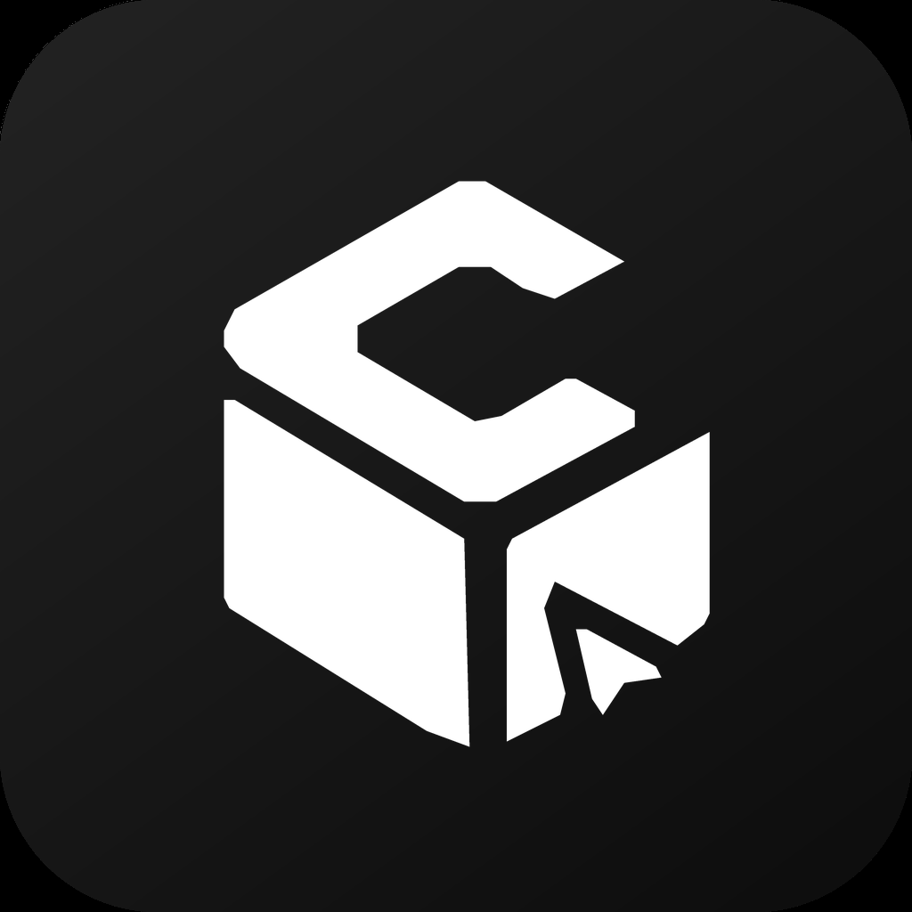

<div align="center">



# ClerkBox

**A local-first AI desktop workbench: multi-provider chat, MCP tool ecosystem, sub-agents, skills, workbench, and VIBE immersive mode.**

[](https://github.com/XMZF-vAI/clerkbox/releases)
[](LICENSE)
[](https://www.electronjs.org/)
[](https://react.dev/)
[](https://www.typescriptlang.org/)
[](#download-and-install)

</div>

**English** | [简体中文](README.md)

---

> ClerkBox is a local-first AI desktop workbench. It brings multi-provider chat, a ReAct tool loop, sub-agent orchestration, reusable skills, long-term memory, and VIBE immersive mode together in a cross-platform desktop app (Windows / macOS / Linux), so you can search, write, code, and automate from a single panel.

> ClerkBox is built by [XMZF Studio](https://github.com/XMZF-vAI) — the author is a 7th-grade student. Bug reports and ideas are very welcome via Issues.

---

## Table of Contents

- [Highlights](#highlights)
- [Core Capabilities](#core-capabilities)
- [Download and Install](#download-and-install)
- [Build from Source](#build-from-source)
- [Quick Start](#quick-start)
- [Configuration](#configuration)
- [Tool System](#tool-system)
- [Sub-Agents](#sub-agents)
- [Skills System](#skills-system)
- [MCP Servers](#mcp-servers)
- [Long-Term Memory](#long-term-memory)
- [Workbench Panel](#workbench-panel)
- [Git Integration (Coding Mode)](#git-integration-coding-mode)
- [Desktop Control & Agent Browser](#desktop-control--agent-browser)
- [Message Rewind & File Rollback](#message-rewind--file-rollback)
- [Interface Modes](#interface-modes)
- [Scheduled Tasks](#scheduled-tasks)
- [Harness Compatibility Modes](#harness-compatibility-modes)
- [Workflow Orchestration](#workflow-orchestration)
- [IM Bot Remote Control](#im-bot-remote-control)
- [/goal Mode](#goal-mode)
- [WebUI Remote Access](#webui-remote-access)
- [VIBE Immersive Mode](#vibe-immersive-mode)
- [Theme & Appearance](#theme--appearance)
- [Project Structure](#project-structure)
- [Tech Stack](#tech-stack)
- [Roadmap](#roadmap)
- [Contributing](#contributing)
- [License](#license)
- [Acknowledgements](#acknowledgements)

---

## Highlights

| Capability | Description |
| --- | --- |
| **Multi-provider presets** | 22 built-in provider presets (Joule / OpenAI / Anthropic / Gemini / DeepSeek / Qwen / Zhipu GLM / Ollama, etc.), plus custom endpoints. Each provider pulls its model list from `/models` automatically. OpenAI or Anthropic protocol supported. |
| **ReAct tool loop** | Reason → call tools → observe → reason again, up to 500 iterations with an automatic wrap-up summary, abortable at any time. |
| **MCP tool ecosystem** | Connect Model Context Protocol servers and inject external tools into the conversation; one-click install from the MCP Hub China marketplace in the extension store. |
| **Approval modes** | manual / auto / full approval tiers, plus a `/` command menu for the Spec / Plan / Goal workflows; switching to full access needs a risk-confirmation gate. |
| **Permission rules & approval cards** | In-chat approval cards preview the command / write diff; allow / deny rules can be persisted per project and survive restarts; dangerous commands only ever offer "allow once", and deny wins over full access. |
| **Sub-agent orchestration** | Built-in read-only Scout and full-tool General assistant, plus custom sub-agents via frontmatter with isolated contexts. |
| **Skills auto-discovery** | Full skill catalog injected into context — the AI discovers and loads skills on demand without manual activation; extension store / MCP Hub / 6 bundled preset skills out of the box. |
| **/goal mode** | Session goals are evaluated every round (in-progress / achieved / impossible) and the agent auto-continues; the AI can proactively produce TodoList plan cards and ask questions on key decisions. |
| **Scheduled tasks** | Daily / weekday / weekly / monthly local scheduled tasks; the AI may propose changes, which only take effect after you confirm them. |
| **Harness compatibility modes** | Switch the prompt and tool conventions above the input box: besides the default, compatible with Codex / Grok Build / DeepSeek (dsh) / ZCode styles. |
| **Workflow orchestration** | The AI writes a multi-step task as an orchestration script and dispatches sub-agents in the background; scripts can be saved and re-run, and a failed run can resume from its journal (completed steps cost zero tokens). |
| **IM bot remote control** | Bind Weixin / Feishu / Telegram / WeCom and drive tasks from a phone chat; the bot shares the same sessions as the desktop app, and credentials are encrypted at the OS level. |
| **Workbench panel** | Trae-style right-side workbench: file tree / terminal / browser / sub-agents in one place. |
| **Long-term memory** | `user` / `feedback` / `project` / `reference` memory entries persist across sessions. |
| **Thinking & per-model tuning** | Per-model thinking toggle / tiers (low / medium / high), temperature and token limits; model picker groups models by thinking capability. |
| **AGENTS.md project instructions** | Auto-reads `AGENTS.md` from the working directory and injects it into the system prompt; falls back to `CLAUDE.md`. |
| **VIBE immersive mode** | Fullscreen background in three modes (single / slideshow / glass), liquid-glass UI, and a floating music player (system audio supported). |
| **MD3 dynamic theming** | Material Design 3 color engine with light / dark / system modes and custom seed color. |
| **WebUI remote access** | Built-in web server exposes the full UI to any browser; binds to localhost by default, with a one-click LAN toggle and scan-to-connect QR code, real-time data sync between desktop and web, and an auto-switching mobile layout on narrow screens. |
| **Local-first** | All sessions, memory, skills, and config live on disk — no cloud dependency. |

---

## Core Capabilities

### 1. Multi-Provider Chat

`src/lib/provider-catalog.ts` ships **22 provider presets** sorted into 6 groups: official / international / china / aggregator / local / custom.

- Presets only fill in the baseUrl and protocol (OpenAI or Anthropic) when adding a provider
- Model IDs are pulled live from each provider's `/models` endpoint, so the catalog never goes stale
- Switch the current model at any time during a session; the main agent and sub-agents can use different models
- Thinking-capable models are auto-detected by keyword match; unmatched models can be toggled manually in per-model settings
- **Per-model advanced settings**: configure thinking toggle / tiers, temperature, context budget and output limits independently for each model

### 2. ReAct Tool Loop

The main agent uses the standard ReAct (Reasoning + Acting) pattern:

```
User input
   ↓
LLM reasoning (thinking)
   ↓
Tool call (read_file / search_content / execute_command / ...)
   ↓
Tool results flow back
   ↓
Keep reasoning or return the final answer
```

- Streaming output with real-time thinking display
- Hit **Stop** at any time to abort, including force-kill of child processes
- Dangerous commands (`rm -rf`, `format`, `Stop-Computer`, etc.) are auto-blocked and require confirmation
- **Hardened toolchain**: `read_file` pagination with truncation-resume, command timeouts (120s default) with oversized-output spill, ripgrep-accelerated search, doom-loop detection, truncated-response refusal — long sessions stay stable and cheap

### 3. Sub-Agent Orchestration

Complex tasks can spawn sub-agents running in isolated contexts:

| Agent | Type | Capabilities |
| --- | --- | --- |
| `explore` Scout | Read-only | `search_files`, `search_content`, `read_file`, `web_search`, `web_fetch` |
| `general` Assistant | All tools | Inherits all parent-agent tools, runs independently over multiple turns |
| Custom agent | Custom | Configure tools / model / maxTurns / systemPrompt via frontmatter |

Sub-agents only return a **final summary** to the parent agent, so the main context stays clean.

### 4. Skills System

Skills are reusable capability packs (`SKILL.md` + frontmatter) bundled with the installer or installed from the marketplace, complete with scripts and reference material:

- **Auto-discovery**: the full skill catalog is injected into context (with in-budget three-level degradation) — the AI discovers and loads skills on demand, no manual activation needed
- **Bundled preset skills**: six skills (docx / pdf / pptx / xlsx / find-skills / create-skill) ship with the installer and are seeded on first launch
- **Extension store**: a dual-tab marketplace for skills and MCP servers, backed by CocoLoop Hub and MCP Hub China — one-click install, persisted to disk
- **`/slug` direct activation**: type `/skill-name` to activate instantly; trigger-word hits bring a loading reminder
- See [Skills System](#skills-system) and [MCP Servers](#mcp-servers) for details

### 5. MCP Server Ecosystem

Connect external tool servers via the Model Context Protocol; their tools register dynamically into the conversation loop:

- **One-click install**: browse MCP Hub China servers from the MCP tab of the extension store
- **Custom servers**: add manually via stdio / SSE transports
- See [MCP Servers](#mcp-servers) for details

### 6. Long-Term Memory

Memory entries are organized by type under `.clerkbox/memory/`:

| Type | Purpose |
| --- | --- |
| `user` | User preferences, background, tech stack (cross-project) |
| `feedback` | User feedback and corrections |
| `project` | Project-level rules, conventions, decisions |
| `reference` | Reference materials, links, notes |

The agent writes entries via the `save_memory` tool and retrieves them through a frontmatter index.

### 7. AGENTS.md Project Instructions

ClerkBox follows the cross-tool standard: at the start of every session, it auto-reads `AGENTS.md` from the working-directory root and injects it into the system prompt, so the AI immediately knows the project's stack, build commands, and coding conventions.

- **Cross-tool standard**: `AGENTS.md` is the common convention promoted by [agentskills.io](https://agentskills.io) and [agents.md](https://agents.md); natively supported by OpenAI Codex, OpenCode, Qwen Coder, etc.
- **CLAUDE.md fallback**: under **Settings → General**, enable "CLAUDE.md compatibility" to fall back to `CLAUDE.md` when `AGENTS.md` is absent
- **Fully optional**: turn injection off if you don't need it

### 8. VIBE Immersive Mode

One click to enter a focused conversation environment. See [VIBE Immersive Mode](#vibe-immersive-mode) for details.

---

## Download and Install

Download the latest `ClerkBox Setup x.x.x.exe` from [Releases](https://github.com/XMZF-vAI/clerkbox/releases) and double-click to install.

- Installer size: ~200 MB
- Supports Windows 10 / 11 (x64)
- NSIS installer with a built-in EULA page, optional install path, desktop shortcut, and uninstaller

---

## Build from Source

### Requirements

- **Node.js** ≥ 18 (20 LTS recommended)
- **npm** ≥ 9 or **pnpm** ≥ 8
- **Windows 10/11** (currently builds for Windows only)

### Steps

```bash
# 1. Clone the repo
git clone https://github.com/XMZF-vAI/clerkbox.git
cd clerkbox

# 2. Install dependencies
npm install

# 3. Start dev mode (Vite + Electron together)
npm run dev

# 4. Build production (compile Electron main + Vite bundle + electron-builder NSIS installer)
npm run build
```

Build artifacts land in `release-out/`:

- `ClerkBox Setup x.x.x.exe` — NSIS installer
- `ClerkBox Setup x.x.x.exe.blockmap` — incremental-update blockmap
- `latest.yml` — electron-updater metadata
- `win-unpacked/` — unpacked directory

### npm scripts

| Command | Purpose |
| --- | --- |
| `npm run dev` | Start dev server (port 5175) and Electron |
| `npm run dev:alt` | Same, using port 5176 (when 5175 is busy) |
| `npm run build:electron` | Compile Electron main-process TypeScript only |
| `npm run build` | Full production build (generates installer) |
| `npm run preview` | Preview the built frontend with Vite |

---

## Quick Start

1. **First launch**: complete the welcome tour, choose a theme and color scheme
2. **Add a provider**: go to **Settings → API Config → Add Provider**, pick one of the 22 presets, and enter your API key. Model IDs auto-populate from the provider's `/models` endpoint.
3. **Pick a working directory**: click the button at the bottom of the sidebar to choose a project folder
4. **(Optional) Add AGENTS.md**: drop an `AGENTS.md` at the working-directory root to describe your project stack and conventions
5. **Start chatting**: type your request, for example:
   - "Refactor the parseDate function in src/utils.ts"
   - "Analyze this project's dependency structure"
   - "Search for all TODO comments and list them"
6. **Spawn sub-agents**: the agent decides automatically whether a sub-agent is needed for complex subtasks
7. **Set a goal and let it run**: type a goal command to enter goal mode — the AI evaluates progress each round and auto-continues until done
8. **Enter VIBE mode**: click the VIBE button in the title bar

---

## Configuration

All configuration is managed through the **Settings panel** and persisted locally.

### App Configuration

- **Theme**: `light` / `dark` / `system`
- **Color scheme**: MD3 palette preset or custom seed color
- **VIBE mode**: background image, music source
- **Working directory**: project directory bound to the current session
- **Data directory**: defaults to `%APPDATA%/ClerkBox`
- **Language**: Chinese (default) / English, switchable at runtime
- **AGENTS.md injection**: auto-read `AGENTS.md` from the working-directory root into the system prompt; optional `CLAUDE.md` fallback
- **Token usage**: total API calls, input/output tokens, cache writes/hits and hit rate (Settings → General)
- **Per-model advanced settings**: configure thinking toggle / tiers, Temperature, context budget and output Max Tokens independently for each model
- **WebUI remote access**: see [WebUI Remote Access](#webui-remote-access)

### Data Directory Layout

```
.clerkbox/
├── memory/              # long-term memory
│   ├── user/
│   ├── feedback/
│   ├── project/
│   └── reference/
├── skills/              # installed skills (incl. seeded preset skills)
│   └── <slug>/
│       └── SKILL.md
├── agents/              # custom agents
│   └── <name>.md
```

> The user home directory also hosts `~/.clerkbox/` (global skill library, oversized command-output spill under `tmp/`, etc.).

---

## Tool System

The agent can call the following tools to get work done:

### File Operations

| Tool | Description |
| --- | --- |
| `read_file` | Paginated file reading (`offset` / `limit`), 50KB max per call, with a resume hint when truncated |
| `read_image` | Reads structured metadata of an image file (format, pixel dimensions, file size, top-5 dominant colors); it is not visual recognition |
| `write_file` | Write a file (subject to the permission engine and approval mode) |
| `search_replace` | Precise string-match local edit (no line numbers; CRLF normalization, staleness detection, fuzzy-miss suggestions) |
| `list_dir` | List directory contents |
| `search_files` | Search files by glob pattern (ripgrep first, built-in fallback) |
| `search_content` | Search file contents by regex (ripgrep first) |

### Web Tools

| Tool | Description |
| --- | --- |
| `web_search` | Web search (parses cn.bing.com HTML, no API key needed) |
| `web_fetch` | Fetch a webpage, auto-falling back to a hidden BrowserWindow to render SPAs |

### System & Extension Tools

| Tool | Description |
| --- | --- |
| `execute_command` | Execute shell commands (dangerous commands auto-blocked; 120s default timeout, 600s max; output over 50KB spills to a file) |
| `spawn_agent` | Spawn a sub-agent for a subtask |
| `send_message_to_agent` | Send a follow-up message to an existing sub-agent (steers it if running, resumes it with its context if finished) |
| `save_memory` | Write a long-term memory entry |
| `search_memory` | Search long-term memory entries by keyword or type |
| `question` | Ask the user 1-3 multiple-choice questions and wait for the answers (for key decisions) |
| `todowrite` | Maintain the task checklist for the current task (used for multi-step work) |
| MCP tools | Tools exposed by connected MCP servers register dynamically and run in the same loop as built-ins |

### Security Mechanisms

- **Approval modes**: manual (confirm each time) / auto (whitelist pass-through) / full (allow all), TRAE-style
- **Dangerous command blocking**: `DANGEROUS_PATTERNS` blacklist covers `rm -rf`, `format`, fork bombs, `Stop-Computer`, etc.
- **Write whitelist**: Plan mode only allows writes under `.clerkbox/plan/`
- **Path validation**: path traversal (`..`), UNC network shares, NTFS alternate data streams (ADS) and Windows device names are rejected; relative paths resolve against the session working directory, absolute paths are used as given (cross-directory reads and writes remain subject to the permission engine and approval mode)
- **Doom-loop guard**: repeated identical tool calls are refused automatically
- **URL scheme validation**: `openExternal` only allows `http://` / `https://`

---

## Sub-Agents

### Built-in Agents

#### Scout (`explore`)

A read-only recon agent, great for broad searches and multi-file reading:

- Only `read_file` / `list_dir` / `search_files` / `search_content` / `web_search` / `web_fetch`
- Default 30-turn limit
- Never creates, modifies, or deletes any files

#### General (`general`)

A general-purpose sub-task executor:

- Inherits all parent-agent tools
- Default 50-turn limit
- Isolated context, returns only a final summary

### Custom Agents

Create a Markdown file in `.clerkbox/agents/`:

```markdown
---
name: translator
description: Chinese-English translation expert
whenToUse: use when high-quality translation is needed
tools: [read_file, write_file, web_search]
disallowedTools: [execute_command]
model: deepseek-chat
maxTurns: 20
color: purple
---

You are a Chinese-English translation expert. Rules:
- Preserve the original tone and style
- Prefer industry-standard terminology for technical documents
- Output a bilingual comparison when done
```

Field reference:

| Field | Required | Description |
| --- | --- | --- |
| `name` | Yes | Agent type identifier (unique) |
| `description` | No | Display name |
| `whenToUse` | No | When to use this agent |
| `tools` | No | Allowed tools; `[*]` means all |
| `disallowedTools` | No | Disallowed tools |
| `model` | No | Model ID |
| `maxTurns` | No | Max iteration turns |
| `color` | No | Accent color (blue/green/purple/...) |

---

## Skills System

### Skill Format

Each skill is a directory containing a `SKILL.md` file:

```markdown
---
name: code-reviewer
description: Code review expert
version: 1.0.0
---

You are a senior code review expert. When reviewing, focus on:
1. Security vulnerabilities
2. Performance issues
3. Readability
4. Error handling

Output format:
- Severity (high/medium/low)
- Problem description
- Fix suggestion
```

### Installing Skills

- **Preset skills**: six skills (docx / pdf / pptx / xlsx / find-skills / create-skill) ship with the installer and are seeded into `.clerkbox/skills/` on first launch
- **From the extension store**: click "Skills" in the sidebar → skills tab → one-click install (data source: [CocoLoop Hub](https://hub.cocoloop.cn)); installs persist to the local skill library and survive restarts
- **Manually**: put the skill directory into `.clerkbox/skills/<slug>/`
- **From a URL**: the marketplace accepts a GitHub raw URL to pull a remote SKILL.md

### Skill Auto-Discovery

Modeled after Claude Code / Codex, ClerkBox lets the AI use skills without manual activation:

- **Full catalog injection**: every skill's name / description / path is injected as a lightweight catalog (8000-char budget, 250 chars per entry, automatic three-level degradation when over budget); active skills are pinned to the top with a ⚡ marker
- **Smart trigger reminders**: when the conversation hits a skill's `trigger_keywords` or name, a `<system-reminder>` nudges the AI to load it
- **On-demand full load**: the AI reads the full `SKILL.md` via `read_file`; loaded skills show as chips on the message bubble
- **`/slug` direct activation**: type `/skill-name` in the input to activate instantly, with optional trailing prompt; a bare `/slug` only activates
- **Task-shift awareness**: Skill Router guidance tells the AI to re-check for better-matching skills when the task focus changes

### Enable / Disable

Skills can be selectively enabled per session; active skills are pinned in the catalog with guaranteed full-text availability, and can be toggled anytime.

---

## MCP Servers

ClerkBox connects to external tool servers via the [Model Context Protocol](https://modelcontextprotocol.io), so conversations can call the third-party tool ecosystem directly.

### Install & Manage

- **One-click install**: switch to the MCP tab in the Skills panel and browse servers from [MCP Hub China](https://mcp.cocoloop.cn)
- **Custom servers**: add manually via stdio local commands or remote endpoints
- **Toggle per server**: enable / disable each server independently, with live connection status

### How It Works

- Tools from enabled servers register dynamically at session start and run in the same ReAct loop as built-ins (`read_file` / `execute_command`...)
- Tool results flow back in a unified format, with streaming and abort support
- MCP connections are owned by the main process; the renderer accesses them over IPC

---

## Long-Term Memory

The memory system lets the agent keep understanding your projects and preferences across sessions.

### Memory Types

| Type | Directory | Purpose |
| --- | --- | --- |
| `user` | `.clerkbox/memory/user/` | User profile: preferences, background, tech stack, style |
| `feedback` | `.clerkbox/memory/feedback/` | User feedback and corrections |
| `project` | `.clerkbox/memory/project/` | Project-level conventions, architectural decisions, rules |
| `reference` | `.clerkbox/memory/reference/` | Reference materials, links, notes |

### Memory File Format

```markdown
---
name: preferred-stack
description: User's preferred frontend stack
type: user
mtime: 2026-07-20
---

User preferences:
- Framework: React 19 + TypeScript
- State: Zustand
- Styling: Tailwind CSS
- Build: Vite
```

The agent writes entries via the `save_memory` tool, and scans the frontmatter index at session start to quickly load relevant entries.

---

## Workbench Panel

A Trae-style right-side workbench that keeps the agent's working context in one place (WorkbenchPanel):

- **Files**: working-directory file tree with click-to-preview
- **Terminal**: built-in PTY terminal (node-pty) — watch the agent's commands live or step in manually
- **Browser**: embedded web view
- **Sub-agents**: sub-agent run status and output

The panel shares the same working directory as the conversation and can be collapsed.

---

## Git Integration (Coding Mode)

Switching the interface mode to "Coding" lights up the Git capability surface; "General" hides all of it and the UI stays focused on results:

- **Branch switcher**: a chip above the input shows the current branch and change count; the popover searches / switches / creates branches; hidden automatically when the session folder is not a Git repository
- **Change review**: the workbench Git panel shows unstaged / staged changes and per-file diffs, supports multi-select commits and one-click push (auto-linked to the first remote when there is no upstream)
- **Commit graph**: a swim-lane SVG commit graph (branches converging / merges forking are colour-coded), 50 commits per page with scroll loading; click a row for details
- **Safety boundary**: the main-process git service calls the CLI with the shell disabled and normalises git stderr into stable error codes; none of these channels are exposed to the remote WebUI

---

## Desktop Control & Agent Browser

Both capabilities act as the user on this machine and are **fail-closed by default** (they only get a channel when you turn them on in settings):

- **Computer Use**: the AI synthesises real keyboard and mouse events to drive desktop tasks; an on-screen trail plus a status badge shows "controlling your computer", Escape is a global kill switch, and the approval tier is separate from ordinary commands
- **Agent browser**: a separate, controlled browser partition where the AI can navigate / click / fill forms / read pages; the workbench panel shows the operation live, and sessions are isolated from each other
- Every action enters the same approval flow as ordinary tools; the remote WebUI can never trigger them

---

## Message Rewind & File Rollback

- **Rewind**: rewind / edit-and-resend / retry from any turn; the conversation is physically truncated (a rewind is a real delete, there is no hidden branch)
- **File rollback**: a snapshot is taken before every write, and rewinding rolls the file back by path; content fingerprints are compared before rolling back
- **Safety first**: files changed externally after the snapshot are marked `external_modified`, refused for automatic rollback, and listed for you to handle; execution goes through a transaction log with reverse-order compensation, and an interruption can be recovered

---

## Interface Modes

A pill switch to the right of the brand bar in the sidebar toggles **Coding / General** in one click (`Ctrl+Shift+U`):

- **Coding mode**: full technical detail — commands, diffs, the Git surface, working directory hints
- **General mode**: focused on task progress and result summaries; command lines and Git details are hidden, and greetings / placeholders switch to work-oriented copy
- The mode is a pure presentation preference; it changes neither the agent's permissions nor its capabilities (aligned with ZCode's interface-mode architecture)

---

## Scheduled Tasks

Local scheduled tasks, a first-class citizen of agent orchestration:

- A task list plus a sidebar entry; tasks fire on schedule, run in the chosen session, and push the result back
- Daily / weekday / weekly / monthly cycles, with a configurable time of day
- The AI may propose task changes (create / modify / pause), and **every proposal takes effect only after you confirm it**; a sidebar badge shows how many are waiting

---

## Harness Compatibility Modes

Pick the prompt and tool conventions above the input box; the choice locks after the first message:

- **Default**: ClerkBox's native harness
- **Compatible tiers**: prompt and tool-call conventions in the style of Codex / Grok Build / DeepSeek (dsh) / ZCode, so users of other CLIs can start without friction

---

## Workflow Orchestration

Write a multi-step task as an orchestration script and let it run in the background:

- **Scripted**: the AI writes a workflow script with the `agent()` / `parallel()` / `phase()` / `log()` primitives
- **Parallel**: steps inside `parallel()` dispatch sub-agents concurrently and report progress segment by segment (the card shows a swim-lane diagram; the script source can be expanded)
- **Save and re-run**: workflows can be stored under `<working directory>/.clerkbox/workflows/` and reused by name; a failed run can resume from its journal, and already-completed steps cost zero tokens
- **Writes still need approval**: steps that write files or run commands go through the approval card as usual, and dangerous steps never get an "always allow for this session" option

---

## IM Bot Remote Control

Connect Weixin / Feishu / Telegram / WeCom to this machine and drive tasks from a phone chat:

- **Chat is the interface**: send a message to the bot and it runs in a session on this machine; the result comes back to the same chat
- **Same sessions as the desktop**: the phone and the desktop see the same sessions and messages, not a separate copy
- **Encrypted credentials**: IM account credentials are stored with OS-level encryption (safeStorage); bind codes are single-use
- **Approvals on the phone too**: the approval card for a dangerous command is pushed to the chat, where a short list of numbers approves or denies it; the scope stops at "this once" and never silently widens to "always allow for this session"

---

## /goal Mode

Modeled after Claude Code's goal mechanism, long tasks keep moving on their own:

- **Set a goal**: enter a goal via the `/` command menu; a persistent goal banner appears above the input
- **Auto evaluation**: an independent evaluator at the end of each tool loop judges **in-progress / achieved / impossible** and shows its reasoning
- **Auto-continue**: "in-progress" automatically starts the next round until the goal is achieved or confirmed impossible; stop any time
- **Restart-safe**: goal state persists locally and survives app restarts

Companion interactive cards keep the AI communicating proactively:

- **TodoListCard**: the AI proposes a task plan checklist and checks items off as it progresses
- **QuestionCard**: the AI asks the user about key decisions — click an option to answer
- **Skill chips**: loaded skills show as chips on the message bubble

---

## WebUI Remote Access

ClerkBox ships with a built-in web server that exposes the full UI to any browser for remote control — perfect for deploying the app on a server and accessing it from any device.

### How to Start

- **Manual start from desktop**: click the 🌐 icon above the settings button in the sidebar. A dialog shows the tokenized access URL — copy it with one click or open it directly in your default browser. The service can be stopped from the same dialog at any time.
- **LAN access & QR scan**: ticking "Allow LAN access" in the dialog binds the server to all network interfaces and generates a QR code when a LAN IP is detected — scan it with your phone to connect instantly (shown only when LAN access is on and a network adapter address is found; never points to localhost).
- **Auto start for servers**: set the environment variable `CLERKBOX_WEBUI_AUTO=1` before launching the app; the WebUI starts automatically and prints the access URL to the console (auto-start binds to localhost by default — enable LAN access in the desktop app first for remote use).

### Features

- **Full functionality**: chat, tool calls, streaming output (SSE), settings, and skills work the same as on desktop
- **Real-time data sync**: settings, skills, VIBE config, and token usage are synchronized between desktop and web via a shared main-process store; sessions and messages share the same local database
- **Security**: a random token is generated on every start and required for all API requests; the static file server includes path-traversal protection
- **Adaptive UI**: window control buttons (minimize / maximize / close) are automatically hidden in WebUI mode
- **Mobile layout on narrow screens**: the web page switches to a mobile UI (large touch targets, bottom-sheet menus, virtual-keyboard avoidance) for convenient use on phones
- **Browser files**: the local or third-device WebUI can upload one file at a time to the host (10MB per file by default) and choose a host working directory from a directory browser

### Notes

- The WebUI binds to `127.0.0.1` with a random port by default, so it is only reachable from this machine; after ticking "Allow LAN access" it binds to `0.0.0.0` and any device on the same LAN can reach it. For public deployment, use a reverse proxy with HTTPS
- Browser WebUI cannot open the host's native file-picker dialogs, so it uses browser uploads and a host-folder browser instead. Uploads default to 10MB per file and can be adjusted with `CLERKBOX_WEBUI_MAX_UPLOAD_MB` (1-100MB)
- API keys are kept in OS-level encryption (safeStorage) and never enter the shared store in plaintext
- **The remote view does not read local files by default**: the workbench file panel, VIBE wallpapers and approval diff previews all need file read access, which you have to enable explicitly with "Allow remote browsing of local files". Those channels accept arbitrary paths, so a leaked token exposes file contents — enable them only on a trusted network
- **The remote view cannot run the agent on your machine**: agent orchestration, dangerous-command approvals, rewind / rollback, MCP tool execution and Git writes are desktop-only; the remote view can only watch. API keys are never sent to the remote side either
- For server deployments, `CLERKBOX_WEBUI_AUTO=1` starts the WebUI automatically and `CLERKBOX_WEBUI_ALLOW_FILE_ACCESS=1` grants remote file read access (not granted by default)

---

## VIBE Immersive Mode

Switch to a distraction-free focus environment with one click.

### Features

- **Fullscreen background**: default fullscreen image, custom web or local images supported
- **Liquid-glass UI**: message bubbles, input, and controls use `liquid-glass` frosted-glass effects
- **Music player**: floating controller in the top-right, single track / folder playback
- **Customize menu**: glass menu in the bottom-left to configure background and music
- **Persistence**: all VIBE config persists and auto-restores on launch

### Enter / Exit

- Click the **VIBE** button in the title bar to enter
- Click the **Exit** button in the bottom-right to exit
- Normal UI state is fully preserved after exiting

---

## Theme & Appearance

ClerkBox uses the Material Design 3 color engine with dynamic theme generation.

### Three Modes

- **Light**: bright palette, for daytime
- **Dark**: default mode
- **System**: follows the system theme automatically

### Color Schemes

Built-in MD3 palette presets: Violet (default), Blue, Green, Orange, Pink, Teal, Indigo. Custom seed colors generate a full palette in real time via `@material/material-color-utilities`.

### Visual Details

- **Rounded window**: 12px rounded corners, auto-reset to square when maximized
- **Custom title bar**: frameless window + custom window control buttons
- **Wave animation**: themed triple sine-wave animation at the bottom of empty conversations
- **Liquid glass**: unified frosted-glass visual language in VIBE mode

---

## Project Structure

```
ClerkBox/
├── electron/                    # Electron main process
│   ├── main.ts                  # main entry (IPC, filesystem, command execution, etc.)
│   ├── agent-host.ts            # host-mode agent orchestration (event stream, approvals, compaction, queue)
│   ├── db.ts                    # session storage (SQLite primary store + JSON fallback and merge)
│   ├── api-proxy.ts             # model API proxy (streaming chat, connection test)
│   ├── webui-server.ts          # WebUI server (HTTP + SSE + token auth)
│   ├── mcp-manager.ts           # MCP server connections and tool calls
│   ├── updater.ts               # auto-update state machine
│   ├── im-bots/                 # Weixin / Feishu / Telegram / WeCom remote control
│   └── preload.ts               # preload script (contextBridge)
├── src/                         # renderer process (React app)
│   ├── components/
│   │   ├── chat/                # chat-related components
│   │   ├── layout/              # layout components (Sidebar / TitleBar / FileTree)
│   │   ├── onboarding/          # welcome tour
│   │   ├── settings/            # settings panel
│   │   ├── ui/                  # generic UI components
│   │   └── vibe/                # VIBE mode components
│   ├── agent-core/              # agent core shared with the main process (ReAct loop, event protocol)
│   ├── hooks/
│   │   └── use-agent.ts         # core agent hook (ReAct loop, streaming, tool dispatch)
│   ├── lib/                     # core libraries
│   │   ├── agent-registry.ts    # agent registry
│   │   ├── api-adapters.ts      # multi-protocol adapters
│   │   ├── api-transport.ts     # streaming transport layer
│   │   ├── tool-registry.ts     # tool definitions (incl. dynamic MCP tools)
│   │   ├── permission-engine.ts # permission engine (dangerous command detection)
│   │   ├── provider-catalog.ts  # provider preset catalog
│   │   ├── theme-engine.ts      # MD3 theme engine
│   │   ├── prompts.ts           # system prompt construction (static/dynamic split for prefix caching)
│   │   ├── skill-catalog.ts     # skill catalog rendering (in-budget three-level degradation)
│   │   ├── skill-matcher.ts     # skill trigger matching (trigger_keywords / names)
│   │   ├── path-safety.ts       # cross-platform path comparison & safety
│   │   ├── compact.ts           # long-context compaction
│   │   ├── token-estimate.ts    # token estimation
│   │   ├── token-tracker.ts     # token usage tracking
│   │   ├── memory.ts            # memory system
│   │   ├── ipc-client.ts        # IPC client (Electron / WebUI dual mode)
│   │   └── shared-storage.ts    # cross-mode shared persistence
│   ├── stores/                  # Zustand state
│   ├── types/                   # TypeScript type definitions
│   ├── App.tsx                  # app root component
│   ├── main.tsx                 # renderer entry
│   └── index.css                # global styles (Tailwind)
├── build/                       # build assets (icons, installer EULA license.txt)
├── resources/preset-skills/     # preset skills bundled with the installer
├── public/                      # static assets
├── package.json
├── vite.config.ts
├── tailwind.config.ts
├── tsconfig.json
└── tsconfig.electron.json
```

electron-builder configuration lives in the `build` field of [package.json](package.json).

---

## Tech Stack

### Frontend

| Technology | Version | Purpose |
| --- | --- | --- |
| [React](https://react.dev/) | 19 | UI framework |
| [TypeScript](https://www.typescriptlang.org/) | 6 | Type system |
| [Vite](https://vitejs.dev/) | 5 | Build tool |
| [Tailwind CSS](https://tailwindcss.com/) | 3 | Atomic CSS |
| [Zustand](https://github.com/pmndrs/zustand) | 5 | State management |
| [lucide-react](https://lucide.dev/) | 1 | Icon library |
| [Vercel AI SDK](https://sdk.vercel.ai/) | 6 | Streaming LLM calls |
| [@material/material-color-utilities](https://github.com/material-foundation/material-color-utilities) | 0.4 | MD3 color engine |
| [cheerio](https://cheerio.js.org/) | 1.2 | HTML parsing (web_search) |
| [@modelcontextprotocol/sdk](https://github.com/modelcontextprotocol/typescript-sdk) | 1.30 | MCP server integration |

### Desktop

| Technology | Version | Purpose |
| --- | --- | --- |
| [Electron](https://www.electronjs.org/) | 42 | Cross-platform desktop framework |
| [electron-builder](https://www.electronjs.org/) | 26 | Packaging tool |
| [node-pty](https://github.com/microsoft/node-pty) | 1.1 | Workbench built-in terminal |

### Data Storage

- Session history: local SQLite (sql.js WASM, in-memory database with debounced atomic persistence); if the WASM is unavailable the store falls back to a JSON database in the same folder, and on recovery the two are merged by id so neither side loses data
- App config: Zustand persist + localStorage (cross-mode via main-process KV bridge)
- Long-term memory: Markdown files + frontmatter index
- Skills & agents: Markdown files

---

## Roadmap

### Done

- ReAct tool loop + streaming
- Sub-agent orchestration (built-in + custom)
- Skills marketplace (CocoLoop Hub)
- Long-term memory system
- VIBE immersive mode
- MD3 dynamic theming
- Rounded window + custom title bar
- Welcome tour
- Long-context auto-compaction (compact)
- Token usage tracking and stats panel
- Prefix-cache optimization (static/dynamic system split + frozen memory snapshot + Anthropic dual breakpoints; 90%+ in-session hit rate)
- Dangerous command blocking
- Automatic file write backup
- i18n (Chinese / English)
- AGENTS.md project instruction injection (cross-tool standard, CLAUDE.md fallback)
- Hard-stop tool execution (main-process child-process tracking and termination)
- Multi-provider presets with automatic `/models` fetching
- Thinking control (toggle / tier modes + model picker grouped by thinking capability)
- Per-model advanced settings (independent temperature / thinking tiers / token limits per model)
- WebUI remote access (browser control + dual-mode data sync + server auto-start)
- MCP server integration (external tool ecosystem + MCP Hub China marketplace)
- Extension store (dual-tab marketplace for skills + MCP)
- Trae-style workbench panel (files / terminal / browser / sub-agents)
- TRAE-style approval modes (manual / auto / full) + `/` command menu (Spec / Plan / Goal workflows)
- /goal mode (end-of-round evaluator + auto-continue + restart-safe)
- TodoList / Question interactive cards and loaded-skill chips
- Skill auto-discovery (full catalog injection + trigger reminders + `/slug` + 6 bundled preset skills)
- Hardened toolchain (read_file pagination, command timeout & output spill, ripgrep-first search, doom-loop guard, truncated-response refusal, search_replace hardening)
- Static/dynamic system-prompt split (better prefix-cache hit rate)
- Context usage indicator with manual compaction
- VIBE upgrade (background single / slideshow / glass modes + system audio)
- Skill marketplace search coverage improvements
- Scheduled tasks (daily / weekday / weekly / monthly + AI change proposals awaiting approval)
- Harness compatibility modes (Codex / Grok Build / DeepSeek (dsh) / ZCode styles)
- Desktop control Computer Use (real keyboard/mouse synthesis + Escape kill switch + on-screen trail)
- Agent browser (separate controlled partition + live operation view)
- Message rewind & file rollback (pre-write snapshot + content fingerprint + transaction log)
- Coding / General interface mode switch (presentation only, aligned with ZCode interface mode)
- Git integration (branch switch / change review / commit & push / swim-lane graph, coding mode only)
- SQLite session storage (sql.js primary store + JSON fallback with incremental merge on recovery)
- Persisted permission rules and write-approval diff cards (per-project allow / deny, survives restarts)
- Workflow orchestration (create / save / resume + parallel sub-agents + journal-based continuation)
- IM bot remote control (Weixin / Feishu / Telegram / WeCom + approvals and questions from the phone)

---

## Contributing

Issues and Pull Requests are welcome.

### Development Flow

1. Fork the repo
2. Create a feature branch: `git checkout -b feature/amazing-feature`
3. Commit your changes: `git commit -m 'feat: add amazing feature'`
4. Push the branch: `git push origin feature/amazing-feature`
5. Open a Pull Request

### Commit Convention

Follow [Conventional Commits](https://www.conventionalcommits.org/): `feat:` / `fix:` / `refactor:` / `perf:` / `docs:` / `chore:` and friends.

### Code Style

- Strict TypeScript
- React function components + Hooks
- Atomic Tailwind CSS
- Prefer `React.memo` + `useMemo` for streaming render performance
- Main-process IPC handlers must validate path legality

---

## License

This project is open source under the [Apache License, Version 2.0](LICENSE).

```
Apache License 2.0

Copyright 2026 XMZF Studio

Licensed under the Apache License, Version 2.0 (the "License");
you may not use this file except in compliance with the License.
You may obtain a copy of the License at

    http://www.apache.org/licenses/LICENSE-2.0

Unless required by applicable law or agreed to in writing, software
distributed under the License is distributed on an "AS IS" BASIS,
WITHOUT WARRANTIES OR CONDITIONS OF ANY KIND, either express or implied.
See the License for the specific language governing permissions and
limitations under the License.
```

---

## Acknowledgements

- [Electron](https://www.electronjs.org/) — cross-platform desktop framework
- [React](https://react.dev/) — UI library
- [Vercel AI SDK](https://sdk.vercel.ai/) — unified LLM layer
- [Material Design 3](https://m3.material.io/) — design system
- [Tailwind CSS](https://tailwindcss.com/) — styling utility
- [CocoLoop Hub](https://hub.cocoloop.cn) — Skills community data source

---

<div align="center">

**[Report a Bug](https://github.com/XMZF-vAI/clerkbox/issues)** · **[Feature Request](https://github.com/XMZF-vAI/clerkbox/issues)** · **[Pull Request](https://github.com/XMZF-vAI/clerkbox/pulls)**

Made by **XMZF Studio** · Apache License 2.0

</div>
